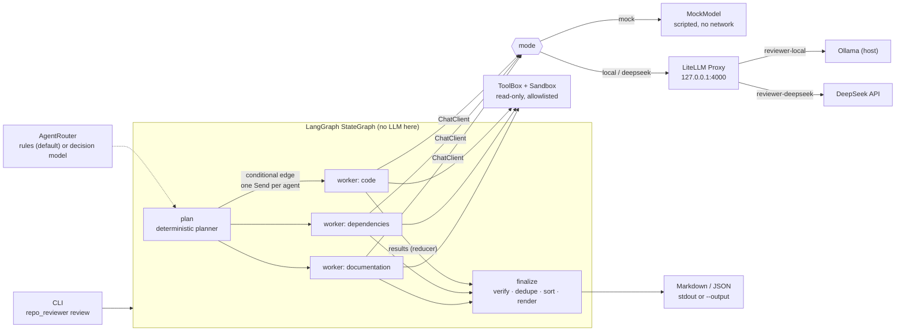

# multi-agent-repo-reviewer

A small, self-hostable, **read-only** multi-agent reviewer for Python repositories. It exists to
teach how the pieces of a multi-agent system fit together, and it is small enough to read in
about 30 minutes.

- **LangGraph** orchestrates a deterministic workflow: plan, fan out to workers with `Send`,
  merge results with a reducer, verify, report.
- Three **specialised, tool-using agents** (code, dependencies, documentation) each get their own
  instructions, tool allowlist, budgets and a bounded tool-calling loop.
- **LiteLLM Proxy** is the single gateway for every real model call. **Ollama** is the default
  local backend; **DeepSeek** is an optional, explicitly selected cloud backend.
- An optional, **experimental decision-model router** shows how a small typed classifier can pick
  agents without replacing LangGraph (see [docs/routing.md](docs/routing.md)).

> Languages: English (this file) · [فارسی](README.fa.md)

## What it does

Reads a Python repository you point it at and produces a Markdown (or JSON) report of findings.
Each finding has an agent name, a file reference (with line when known), a severity, a
description, a recommendation and, normally, a quoted piece of evidence.
Before a finding reaches the report, the orchestrator checks that the cited file exists, the line
exists, and the quoted evidence really appears next to that line.

## What it does not do

- It never writes, edits, executes or installs anything from the reviewed repository.
- It does **not** scan for vulnerabilities and never claims a CVE. The dependency agent only
  talks about pinning and reproducibility.
- "Verified" means *the cited text exists*, not *the model's conclusion is right*. Review every
  finding yourself.
- `MOCK` mode is **not** an LLM. It is a scripted stand-in that exercises the same code paths.
- No database, web UI, Redis, vector store, tracing platform or telemetry.

## Architecture



### The three agents

| Agent (`--agents`) | Does | Tools it may use |
|---|---|---|
| `code` (Code Reviewer) | Exception handling, resource management, simple maintainability | `list_files`, `read_file` |
| `dependencies` (Dependency Analyst) | Unpinned or conflicting constraints, reproducibility risks | `list_manifests`, `read_manifest` |
| `documentation` (Documentation Reviewer) | README vs. project metadata: install, prerequisites, usage | `read_readme`, `list_files`, `inspect_project_metadata` |

Instructions live in [src/repo_reviewer/agents/](src/repo_reviewer/agents/). An agent only receives
the schemas of its own tools, and the `ToolBox` rejects any other tool name even if a model
invents one.

### What LangGraph does here

LangGraph owns the *workflow*: a `StateGraph` over `ReviewState` with three nodes and a
conditional edge. The planner node decides who runs; the edge function returns one
`Send("worker", WorkerInput)` per selected agent, so LangGraph runs the workers concurrently in
one superstep; the `finalize` node runs after all of them.

- **State** (`ReviewState`) is the shared data the graph passes between nodes.
- **`Send`** gives each worker its *own* input (`WorkerInput`): the isolated local context.
- **Reducer**: all workers write `results` at the same time. That is only safe because
  `results` is `Annotated[list[WorkerResult], merge_results]`. The reducer is order-independent
  and idempotent per agent, so the aggregate does not depend on who finishes first. It is the
  only concurrently written key.

The graph makes **no LLM call**. "Agent" here means *LLM + instructions + tools + loop*;
"orchestrator" means plain code.

### What LiteLLM does here

Agents talk to an OpenAI-compatible endpoint. In `local` and `deepseek` modes that endpoint is the
LiteLLM Proxy, which maps the alias `reviewer-local` to Ollama and `reviewer-deepseek` to
`deepseek/deepseek-chat`. The Python code never imports a provider SDK.

### Routing agents vs. routing models

These are two separate decisions made in two separate places:

| | Decides | Done by | Selected with |
|---|---|---|---|
| **Agent routing** | *Which specialists run* | `AgentRouter` + planner (rules by default; optional decision model) | `--agents`, `--router`, `--request` |
| **Model routing** | *Which model answers a call* | LiteLLM alias → backend | `--mode local` / `--mode deepseek` |

There is **no silent fallback** between them: `config/litellm.yaml` has no `fallbacks`, so a
failing local model produces an error, never a cloud call.

## Quickstart (MOCK mode: no Docker, no API key, no network)

Requires Python 3.12+ and [uv](https://docs.astral.sh/uv/).

```bash
git clone <your-fork-url> multi-agent-repo-reviewer
cd multi-agent-repo-reviewer
uv sync
uv run python -m repo_reviewer review ./sample_project --mode mock
```

Without uv: `python -m venv .venv`, activate it, `pip install -e .`, then
`python -m repo_reviewer review ./sample_project --mode mock`.

More examples:

```bash
uv run python -m repo_reviewer review ./sample_project --agents documentation --mode mock
uv run python -m repo_reviewer review ./sample_project --mode mock --json
uv run python -m repo_reviewer review ./sample_project --mode mock --output report.md --verbose
```

### CLI reference

```
python -m repo_reviewer review PATH [options]
  --mode [mock|local|deepseek]   default: mock
  --agents TEXT                  code, dependencies, documentation (comma-separated or repeated)
  --output PATH                  write the report to a file instead of stdout
  --json                         JSON instead of Markdown
  --verbose                      debug logging on stderr
  --router [deterministic|decision]   how agents are chosen (default: deterministic)
  --request TEXT                 free-text request, used only by the router
  --decision-backend [mock|systemone] backend for --router decision
  --threshold FLOAT              decision-router score threshold (illustrative default 0.5)
  --max-model-calls INT          per agent (default 8)
  --max-tool-calls INT           per agent (default 12)
  --timeout FLOAT                total time budget in seconds (default 300)
  --yes                          skip the DEEPSEEK confirmation

python -m repo_reviewer smoke --mode [local|deepseek]   optional live check of the gateway
```

Progress and diagnostics go to **stderr**; the report goes to **stdout** (or `--output`).

| Exit code | Meaning |
|---|---|
| 0 | Review completed and every selected agent succeeded (findings do not change the code) |
| 1 | Completed, but at least one agent failed: the report is partial |
| 2 | Usage or configuration error (unknown agent, missing key, nothing applicable to run, ...) |
| 3 | Every agent failed (for example the gateway is down) |
| 4 | The target path is not a readable directory |

### Expected output (MOCK mode, abridged)

```text
# Repository review

- **Repository:** `sample_project`
- **Mode:** MOCK (scripted checks, no language model was used)
- **Agents run:** code, dependencies, documentation
- **Routing:** `deterministic` (rules) - no request text; running every applicable agent

## Workers

| Agent | Status | Model calls | Tool calls | Findings |
|---|---|---|---|---|
| code | ok | 3 | 5 | 1 |
| dependencies | ok | 3 | 3 | 1 |
| documentation | ok | 2 | 2 | 3 |

## Findings (5)

4 medium · 1 low

### 3. [MEDIUM] Unpinned dependency 'requests'

- **Agent:** dependencies
- **File:** `requirements.txt:3` (quote verified)
- **Description:** 'requests' has no version constraint, so any release can be installed and builds are not reproducible.
- **Recommendation:** Pin it, e.g. 'requests==<tested version>', and keep a lockfile.
- **Evidence:** `requests`

### 4. [MEDIUM] File I/O without exception handling

- **Agent:** code
- **File:** `src/shelf_tracker/storage.py:7` (quote verified)
...
```

`sample_project/` is a synthetic repository with three planted defects (missing I/O exception
handling, an unpinned dependency, an incomplete README). They are listed in
`sample_project/expected_findings.json`, which the regression test reads.

## Real inference with Ollama + LiteLLM

**Topology (decision):** Ollama runs **on the host**; only the LiteLLM Proxy runs in Docker
Compose. Reason: it gives Ollama direct GPU access on every OS (Docker Desktop on macOS cannot
pass a GPU through), it avoids a multi-gigabyte volume in Compose, and the proxy still reaches it
through `host.docker.internal`. The cost is one extra manual install step.

1. **Install Ollama** from <https://ollama.com/download> and start it.
2. **Pull a model that supports tool calling** and check its capabilities:

   ```bash
   ollama pull qwen3:8b
   ollama show qwen3:8b        # "Capabilities" must include "tools"
   ```

   If you choose another model, change the `model:` line under `reviewer-local` in
   [config/litellm.yaml](config/litellm.yaml) (`ollama_chat/<name>`).
3. **Configure secrets:** `cp .env.example .env`, then set `LITELLM_MASTER_KEY` (generate your
   own; there is no default). Export the same variables in the shell that runs the CLI.
4. **Start the gateway:**

   ```bash
   docker compose up -d
   ```

   Or without Docker: `uv sync --extra gateway`, then
   `OLLAMA_API_BASE=http://127.0.0.1:11434 uv run litellm --config config/litellm.yaml --host 127.0.0.1 --port 4000`.
5. **Smoke test, then review:**

   ```bash
   uv run python -m repo_reviewer smoke --mode local
   uv run python -m repo_reviewer review ./sample_project --mode local
   ```

The proxy is published on `127.0.0.1:4000` only. Do not expose it publicly.

**Networking notes.** macOS and Windows (Docker Desktop): `host.docker.internal` works and
Ollama's default `127.0.0.1` binding is reachable. Linux: Compose adds
`host.docker.internal:host-gateway`, but Ollama bound to `127.0.0.1` is *not* reachable from the
bridge network. Either set `OLLAMA_HOST=0.0.0.0` (this exposes Ollama on your LAN; firewall it) or
bind it to the Docker bridge address and set `OLLAMA_API_BASE` accordingly, or run the gateway
without Docker as shown above.

**Database-free proxy.** The config sets no `database_url`. Unavailable: virtual keys, budgets,
spend logs/tracking, teams, and the Admin UI. Authentication is the single master key.

### Optional: DeepSeek

```bash
export DEEPSEEK_API_KEY=...        # read by the proxy container from .env, never stored in the repo
docker compose up -d
uv run python -m repo_reviewer review ./sample_project --mode deepseek
```

DEEPSEEK mode must be selected explicitly. It prints a warning that **source excerpts are sent
to an external provider** and asks for confirmation (`--yes` skips it; without a terminal and
without `--yes` it refuses).

### Tool-calling limitations of small local models

The loop relies on genuine model tool calls. Small models may: answer in prose instead of
calling a tool, send malformed or wrong-typed arguments, ignore tool output, loop on the same
call, or cite line numbers they never saw. The harness contains these failures (bad arguments
become an error message to the model; call/size/time budgets are hard; unverifiable findings are
discarded and counted; a worker that cannot produce valid JSON is reported as failed) but cannot
make a weak model good. Run `smoke --mode local` first, and treat local findings as leads.

## Optional: decision-model routing (experimental)

```bash
uv run python -m repo_reviewer review ./sample_project --mode mock \
  --router decision --request "check the README install steps and the pinned dependencies"
```

In MOCK mode this uses a lexical stand-in, not a model. Real use needs a self-hosted decision
model behind LiteLLM's Decisions API; read [docs/routing.md](docs/routing.md) for what was and
was not verified before relying on it. A comparison harness is in
[scripts/compare_routers.py](scripts/compare_routers.py).

## Security model

The reviewed repository is **untrusted input**.

- Filesystem tools are read-only and operate through one `Sandbox` that: rejects `..`, absolute
  and drive-letter paths, NUL bytes and `:` in components; refuses **all** symlinks and Windows
  junctions (not just ones that escape); re-checks the resolved path against the canonical root;
  opens files with `O_NOFOLLOW` where available; excludes `.git`, `.env*`, keys, `credentials*`,
  `secrets*` and similar; rejects binaries and non-UTF-8 files; enforces per-file size and
  per-worker file-count limits.
- No tool executes anything. Agents cannot run shell commands, edit files or follow paths.
- Prompt injection is mitigated, not solved: file text is labelled as untrusted data and the only
  tools are read-only, so the worst case of a successful injection is a wrong or misleading
  finding, not an action.
- Bounded: model calls, tool calls, tool-output size, context size, findings per agent, total
  wall-clock time (checked between steps; per-call timeouts bound each model request).
- Secrets come from the environment only. File contents are not logged; logs show paths, counts
  and tool names.
- Limits of the sandbox: a hostile local process racing on the directory can still win a
  time-of-check/time-of-use window; secrets stored in ordinarily named files are not detected.
  Review untrusted code from a user account that cannot read your secrets.
- No telemetry from this project. LiteLLM's old `--telemetry` flag is a no-op in the version
  tested, and the compose file sets `LITELLM_LOCAL_MODEL_COST_MAP` to skip the startup download.
  In DEEPSEEK mode, data goes to DeepSeek by design.

See [SECURITY.md](SECURITY.md).

## Hardware considerations

Local inference is the bottleneck. As a rule of thumb an 8B-parameter model at 4-bit
quantization needs roughly 5-6 GB of VRAM (or RAM when running on CPU), plus context; 16 GB of
system RAM is a comfortable floor. A recent GPU makes reviews take seconds to minutes; CPU-only
runs work but are much slower, and three agents run concurrently (Ollama may queue them). Lower
`--max-model-calls`, review fewer agents at once, or pick a smaller model if you run out of
memory.

## Troubleshooting

| Symptom | Likely cause / fix |
|---|---|
| `LITELLM_MASTER_KEY is not set` (exit 2) | `cp .env.example .env`, set the key, export it in this shell |
| `cannot reach the LiteLLM Proxy` | `docker compose up -d`; check `docker compose logs litellm`; check `REVIEWER_GATEWAY_URL` |
| `gateway rejected the request ... check that LITELLM_MASTER_KEY matches` (HTTP 400 "No connected db" or 401) | The CLI key differs from the one the proxy started with; restart compose after editing `.env` |
| `gateway returned HTTP 4xx/5xx for model 'reviewer-local'` | Ollama not running, model not pulled, or wrong `ollama_chat/<name>` in `config/litellm.yaml`; on Linux see the Ollama binding note |
| `smoke` says the model answered in text | The model does not support tool calling reliably; pick another |
| Agent `FAILED: OutputError ... no JSON` | The model did not return the required JSON; retry, use a larger model |
| Many "discarded" findings | The model cited lines or quotes that do not exist (hallucination) |
| Garbled characters on Windows | Output is written as UTF-8; use a UTF-8 terminal or `--output` |
| `--router decision` says endpoint "is not local" | By design; see `DECISION_ALLOW_REMOTE` in [.env.example](.env.example) |

## Limitations

- Python repositories only; three narrow agents; no cross-file or runtime analysis.
- Findings from models are leads, not facts. Line/quote verification cannot catch a wrong
  conclusion about a real line.
- Evidence matching is textual (whitespace-normalised, +-2 lines).
- Time limits are cooperative: a model call already in flight is bounded by its timeout, not
  killed instantly.
- The decision-model router is experimental and unverified against a real decision model.
- Real-Ollama and real-DeepSeek runs were **not** executed by the author of this change, and
  Compose was exercised on Windows only; see "Verification status".

## How to extend

- **New agent:** add a value to `AgentName`, create `agents/<name>.py` with an `AgentSpec`
  (instructions, tool allowlist, task), register it in `agents/__init__.py`, add a keyword
  pattern in `routing/rules.py` and descriptions in `routing/base.py`, extend the mock model if
  you want MOCK coverage.
- **New tool:** write a function `(sandbox, **args) -> str` in `tools/`, add a `Tool` to
  `ALL_TOOLS` in `tools/toolbox.py`, and list it in the agent's allowlist. Route every file
  access through `Sandbox`.
- **New model backend:** add a `model_list` entry to `config/litellm.yaml` and a mode/alias in
  `config.py`. Nothing in the agents changes.
- **New router or decision backend:** implement `AgentRouter` / `DecisionBackend` (see
  [docs/routing.md](docs/routing.md)).

More detail on the actual code paths: [docs/architecture.md](docs/architecture.md).

## Development

```bash
uv sync
uv run ruff check .
uv run ruff format --check .
uv run pytest
```

CI runs exactly those plus the MOCK end-to-end demo. No model download, Docker or API key is
needed. See [CONTRIBUTING.md](CONTRIBUTING.md).

## Verification status

What was actually run while preparing this repository (Windows 11, Python 3.12.15, uv 0.13.5,
LangGraph 1.2.17, openai 3.37.0, LiteLLM 1.106.3):

- Ruff lint and format check, and the full pytest suite (`uv run pytest`): passed. Three symlink
  tests are skipped on Windows accounts without symlink privilege; a Windows *junction* escape
  test covers the same sandbox rule there. CI also runs on Linux, where the symlink tests run.
- MOCK end-to-end review of `sample_project`, with and without the decision router.
- A real LiteLLM Proxy 1.106.3 loaded `config/litellm.yaml`, served both aliases, and relayed a
  tool call and a final answer from a **fake Ollama server** to this CLI (`smoke` and `review
  --mode local`). This checks the plumbing, not any model.
- `reviewer-deepseek` without a key returned HTTP 401 and no fallback occurred.

- Docker Desktop 29.9.2 / Compose v5.6.1 (Windows): `docker compose config` fails with a clear
  message when `LITELLM_MASTER_KEY` is unset; with it set, the image `docker.litellm.ai/berriai/litellm:main-stable`
  pulled, the container became healthy, the port was published on `127.0.0.1` only, and
  `smoke` and `review --mode local` worked through the container to a **fake Ollama server on the
  host** via `host.docker.internal`. A wrong key was rejected (as HTTP 400 "No connected db" on a
  database-free proxy).

**Not verified:** a real Ollama model (Ollama is not installed here), a real DeepSeek call, any real
decision model, Docker on Linux (the `host-gateway` mapping and the Ollama-binding caveat are
unexercised), and the GitHub Actions workflow.

## License

MIT. See [LICENSE](LICENSE).
