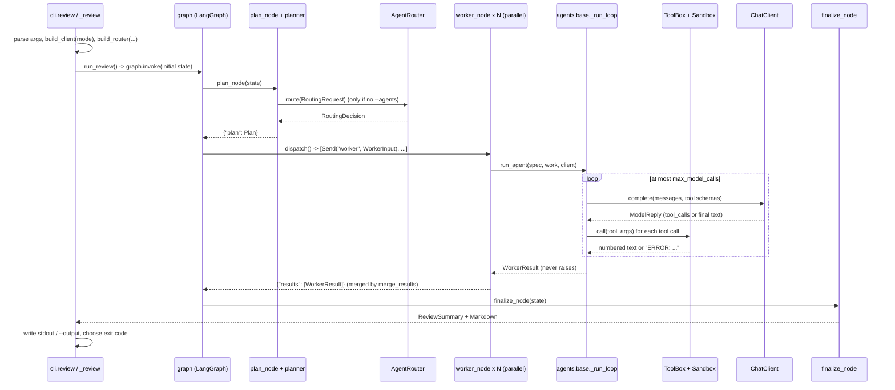

# Architecture: how the code actually works

This document follows the real call path, with file and class names. For the why, read the
[README](../README.md) first.

## 1. One review, end to end



## 2. Modules

| Module | Responsibility | Key names |
|---|---|---|
| `cli.py` | Typer app, argument validation, exit codes, DeepSeek confirmation, wiring | `review`, `_review`, `build_client`, `build_router`, `smoke` |
| `config.py` | Environment-based settings, local-host guard for the decision endpoint | `GatewaySettings`, `DecisionSettings`, `gateway_settings`, `decision_settings`, `ConfigError` |
| `models.py` | All Pydantic types | `Limits`, `RawFinding`, `Finding`, `WorkerInput`, `WorkerResult`, `RoutingDecision`, `ReviewSummary`, `AgentName` |
| `gateway.py` | The only real-inference code: OpenAI client -> LiteLLM Proxy | `ChatClient` (protocol), `LiteLLMGateway`, `ModelReply`, `ToolCall`, `GatewayError` |
| `orchestrator/state.py` | Graph state and reducer | `ReviewState`, `merge_results`, `Plan` |
| `orchestrator/planner.py` | Applicability + agent selection | `scan_facts`, `inapplicable_reasons`, `plan_review`, `NoApplicableAgents` |
| `orchestrator/graph.py` | StateGraph wiring | `build_graph`, `run_review` |
| `orchestrator/validation.py` | Verify, dedupe, sort | `verify_finding`, `deduplicate`, `finalize_findings` |
| `agents/base.py` | The bounded tool loop | `AgentSpec`, `run_agent`, `_run_loop`, `_run_tools`, `_parse_output` |
| `agents/{code_reviewer,dependencies,documentation}.py` | One `AgentSpec` each | `SPEC` |
| `tools/filesystem.py` | Sandbox and file tools | `Sandbox`, `list_files`, `read_file`, `read_readme`, `inspect_project_metadata` |
| `tools/manifests.py` | Manifest tools, requirement parser | `list_manifests`, `read_manifest`, `parse_requirement` |
| `tools/toolbox.py` | Tool registry and per-agent allowlist | `ALL_TOOLS`, `ToolBox`, `ToolPermissionError` |
| `reporting/markdown.py` | Deterministic Markdown | `render_markdown` |
| `testing/mock_model.py` | MOCK mode's scripted `ChatClient` | `MockModel` |
| `routing/` | Agent routing, optional decision model | see [routing.md](routing.md) |

## 3. The graph (`orchestrator/graph.py`)

`build_graph(client, router, agents)` returns a compiled `StateGraph(ReviewState)`:

```
START -> plan -> (conditional edge: dispatch) -> worker -> finalize -> END
```

- `plan_node` calls `scan_facts` (counts only), then `plan_review`, and writes `plan`.
- `dispatch(state)` is the function passed to `add_conditional_edges("plan", dispatch, ["worker"])`.
  It returns a list of `Send("worker", WorkerInput(...))`, one per selected agent. LangGraph runs
  every `Send` target in the same superstep, concurrently (sync nodes run in a thread pool).
  `tests/test_graph.py::test_workers_really_run_in_parallel` proves this with a 3-party
  `threading.Barrier` that only releases if all three workers are inside a model call at once.
- `worker_node(work: WorkerInput)` receives the `Send` payload as its entire input: it never reads
  shared state. It calls `run_agent` and returns `{"results": [result]}`.
- `ReviewState.results` is `Annotated[list[WorkerResult], merge_results]`. Without the reducer,
  three concurrent writes to one key would raise `InvalidUpdateError`. `merge_results` keys by
  agent and sorts by a fixed agent order, so the merged list is independent of completion order.
  A unit test asserts `results` is the *only* reducer-annotated key, i.e. no other key is
  written concurrently.
- `finalize_node` reads the merged `results` and `plan`, calls `finalize_findings`, builds
  `ReviewSummary`, renders Markdown.

`run_review()` is a thin wrapper: build graph, compute the absolute deadline
(`time.monotonic() + limits.total_timeout_s`), `invoke`, unwrap.

**Deterministic vs. autonomous.** Everything in this file is deterministic given its inputs. The
only autonomy is *inside* `_run_loop`: the model decides which of its allowed tools to call next.

## 4. The planner (`orchestrator/planner.py`)

Order of authority:

1. `inapplicable_reasons(facts)`: no `.py` files -> `code` cannot run; no manifest ->
   `dependencies` cannot run. `documentation` always runs (a missing README is a finding).
2. Explicit `--agents` wins; the router is not consulted. If none of the requested agents is
   applicable, `NoApplicableAgents` -> exit code 2.
3. Otherwise `router.route(RoutingRequest(text, applicable, facts.summary()))`. The planner
   intersects the answer with the applicable set, so a router cannot add an inapplicable agent.

The default `RuleBasedRouter` with no `--request` selects every applicable agent. That is the
original behaviour and what runs when you pass neither `--request` nor `--router`.

## 5. The agent loop (`agents/base.py`)

`run_agent(spec, work, client)`: creates a `Sandbox` and a `ToolBox` from `spec.tools`, then
`_run_loop`:

1. Messages start as `[system(spec.system_prompt), user(spec.task)]`. The system prompt's first
   line is `AGENT: <name>` (the mock keys off it), followed by the agent's own instructions and the
   shared JSON output contract.
2. For index in `range(max_model_calls)`: check the deadline; decide `force_final` (last allowed
   call, or context over budget). On a forced final call **no tools are offered** and the model is
   told the budget is reached.
3. If the reply has tool calls and this is not a forced final call, `_run_tools` executes each via
   `ToolBox.call`, catching `ToolError` and feeding `ERROR: ...` back to the model. Over the
   tool-call budget, remaining calls get an "exhausted" message instead of executing. Outputs are
   truncated to `max_tool_output_chars`.
4. Otherwise the reply is the final answer: `_parse_output` strips code fences, extracts the JSON
   object, requires a `findings` list, validates each item as a `RawFinding`. Invalid items are
   counted in `rejected_findings`; an unusable answer raises `OutputError`.
5. `run_agent` converts *any* exception into `WorkerResult(status="failed", error=...)`, so a
   worker never takes the graph down. `worker_node` has a second `except` as a last line of
   defence (for example if `Sandbox` construction fails).

The harness, not the model, sets `Finding.agent`.

## 6. Tools and the sandbox

`ToolBox(sandbox, allowed)` exposes `openai_tools()` (schemas only for allowed tools) and
`call(name, args)`, which re-checks the allowlist (`ToolPermissionError`), parses arguments
(must be a JSON object, only declared keys), and maps `TypeError` to `ToolError`.

`Sandbox.resolve` is the single choke point for paths (see README, Security model).
`Sandbox.read_lines` additionally enforces size, binary/UTF-8 checks and the file budget, and
opens with `O_NOFOLLOW` + `fstat` to narrow the check/use window.
`format_numbered` renders `  12| text` lines; the mock model parses exactly that format back.

## 7. Verification (`orchestrator/validation.py`)

`verify_finding` re-reads the cited file through a fresh `Sandbox` and sets
`verification`: `quote` (evidence found within +-2 lines of the cited line, or anywhere in the file
when no line was given), `line` (the line exists), or `file` (only the file exists). Findings
that fail are counted, never shown. `deduplicate` merges findings with the same file, line and
normalised title (highest severity wins, other agents go to `also_reported_by`). The final list
is sorted by severity, file, line, agent, title.

## 8. MOCK mode (`testing/mock_model.py`)

`MockModel` implements `ChatClient`. It makes scripted tool-call decisions (for example
`list_files`, then `read_file` for each source file) and builds findings from the tool output it
receives, using `ast` for the code agent, a requirement-line parser for dependencies and regexes
for the README. Everything else (graph, planner, sandbox, loop, validation, report, CLI) is the
production code. It cannot show how a real model behaves.

## 9. Routing layer (`routing/`)

`AgentRouter.route(RoutingRequest) -> RoutingDecision`.

- `RuleBasedRouter` (`rules.py`): keyword patterns; no text or no match selects everything.
- `DecisionModelRouter` (`decision.py`): asks a `DecisionBackend` for one probability per
  candidate agent, validates (`validate_scores`), applies a threshold, and falls back to "all
  candidates" on any failure or low confidence.
- Backends (`backends.py`): `MockDecisionBackend`, `StaticDecisionBackend` (test double),
  `SystemOneBackend` (experimental HTTP adapter).

A router sees a `RoutingRequest`: request text and coarse counts/booleans. It never receives file
names or contents. Details: [routing.md](routing.md).

## 10. Where things are tested

| Concern | Test file |
|---|---|
| Sandbox, traversal, symlinks/junctions, tool permissions | `tests/test_sandbox.py` |
| Loop limits, malformed output, permission errors | `tests/test_agent_loop.py` |
| Graph routing, `Send`, parallelism, reducer, failure isolation | `tests/test_graph.py` |
| Verification, dedupe, sorting, Markdown | `tests/test_validation_report.py` |
| CLI, exit codes, DeepSeek prompt | `tests/test_cli.py` |
| End-to-end MOCK against the planted defects | `tests/test_e2e_mock.py` |
| Gateway translation (fake HTTP transport) | `tests/test_gateway.py` |
| Routers, fallback, adapter wire format | `tests/test_routing.py` |
| Comparison script | `tests/test_compare_script.py` |
